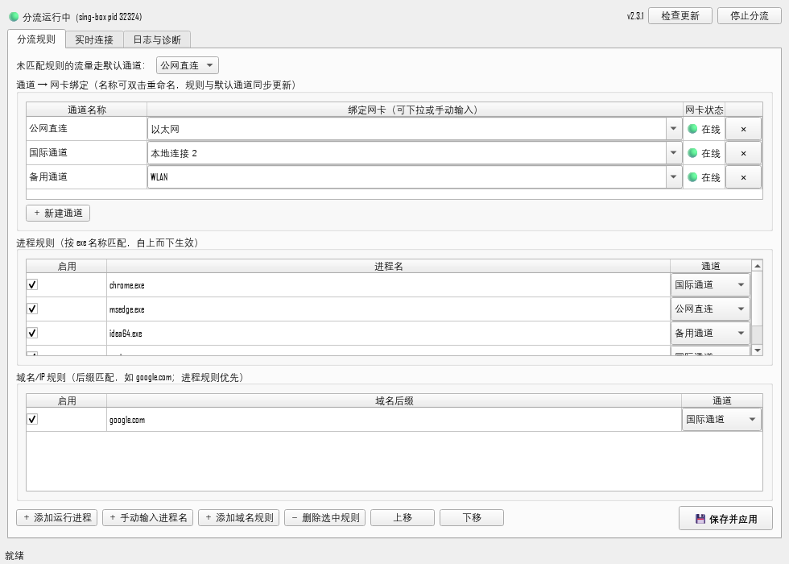
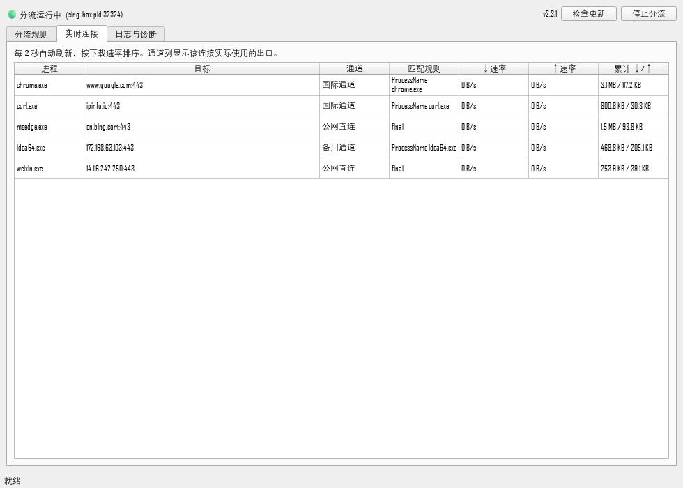
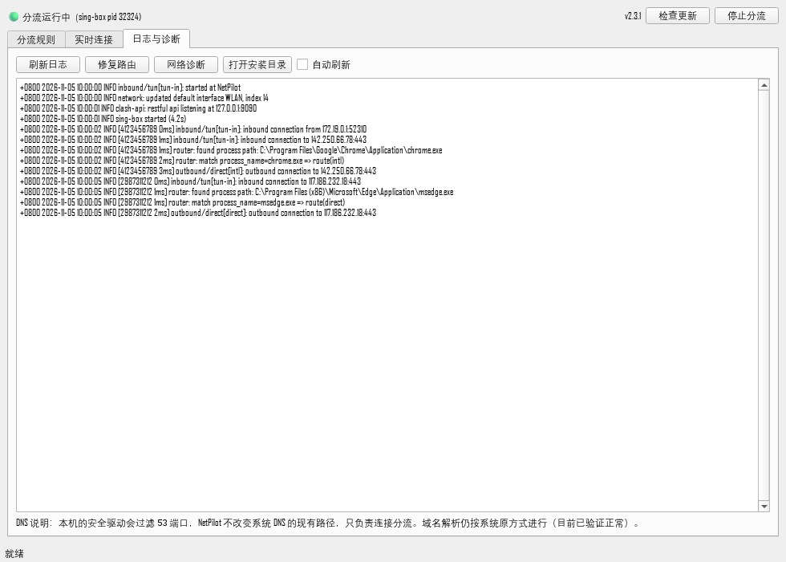

# NetPilot · App Traffic Splitter

[简体中文](README.md) | **English**

> **Route selected applications through selected network interfaces.**

Windows routing only understands *destination IPs*, not *which program* is talking.
NetPilot does one thing — its first principle — **traffic splitting**: every
application's connections are assigned to a specific network adapter (egress).

For example:

- Browser → "International" adapter
- Dev tools → "Backup" adapter
- Everything else → "Direct" adapter by default

All channels stay online at the same time without interfering with each other,
and rules can be changed at any time with sub-second reloads.

*(The UI is currently in Chinese; screenshots below show the actual interface.)*

## Interface

| Routing Rules | Live Connections | Logs & Diagnostics |
|---|---|---|
|  |  |  |

## Features

- **Per-process routing**: assign any `xxx.exe` to an egress channel (works with
  multi-process browsers and UWP apps).
- **Per-domain routing**: `domain-suffix → channel` rules; process rules take precedence.
- **Dynamic channels**: create, rename and delete channels; each channel binds to a
  network adapter. Renames propagate to every rule instantly.
- **Default channel**: unmatched traffic falls back to the default channel.
- **Live connections**: refresh every 2 seconds — process, target, actual channel,
  rates and totals, so you can verify rules really apply.
- **Logs & diagnostics**: core logs, one-click route repair, network diagnostics.
- **System tray**: minimize to tray; right-click to show window, toggle routing,
  or **fully exit** (stops the core, removes routes, shuts down the service — no residue).
- **One-click auto-update**: "Check for updates" downloads the latest release from
  GitHub and applies it, keeping your rules and settings.
- **Self-healing**: single-instance service, orphan core cleanup, startup readiness
  checks and a route watchdog, so it never looks alive while silently not working.
- **One-click recovery**: if anything goes wrong, run `恢复网络.bat`
  (Recover Network) to remove NetPilot routes and stop the core.

## Quick Start

**Requirements**: Windows 10/11 x64. The first start of the core service needs one
administrator consent (UAC). **No Python required.**

1. Download the latest `NetPilot-vX.Y.Z-win64.zip` from
   [Releases](https://github.com/Yuzuru0822/NetPilot/releases) and extract it
   anywhere (`D:\NetPilot` recommended).
2. Run **`NetPilot.exe`**.
3. Click **"启动核心服务（管理员）"** (Start core service) and approve the UAC
   prompt — only needed once per boot (or never, with autostart installed).
4. Click **"启动分流"** (Start routing). The header changes from
   "🟡 starting" to "🟢 running" once the core and its virtual adapter are ready
   (this can legitimately take 1–2 minutes on some machines).
5. In the **"分流规则"** (Routing rules) tab, assign channels to programs:
   - **Channel binding**: each channel maps to one network adapter
     (pick from the dropdown or type the adapter name).
   - **Process rules**: pick from running processes or type an exe name
     (e.g. `chrome.exe`).
   - Click **"💾 保存并应用"** (Save & apply).
6. Open the **"实时连接"** (Live connections) tab to verify the target process is
   actually using the channel you chose.

## Operation Guide

### Channels

- A **channel** is a friendly alias for one network adapter, named as shown in
  *Settings → Network & Internet → Change adapter options* (e.g. `以太网`, `WLAN`,
  `本地连接 2`).
- **Create**: "＋ 新建通道" assigns a stable internal ID; rename, bind an adapter, apply.
- **Rename**: double-click the channel name; rule dropdowns and the default-channel
  dropdown update instantly (rules reference the stable ID, so nothing breaks).
- **Delete**: the ✕ at the end of a row. A channel used by rules or set as default
  cannot be deleted.
- **Note**: if a channel binds to a virtual adapter created by a third-party
  tunnel client, that tunnel must be connected first for the adapter to be "up".
  NetPilot only routes traffic; it does not establish tunnels. Apps assigned to an
  offline channel will lose connectivity — reassign them or connect the tunnel.

### Process Rules

- Exact exe-name matching (e.g. `chrome.exe`), evaluated **top to bottom** —
  reorder with "上移/下移" (move up/down).
- Each row has an enable checkbox, so you can pause a rule without deleting it.
- The built-in rules pinning system/tunnel helper processes to the direct channel
  prevent the tunnel's own traffic from being re-captured — **do not delete them**.

### Domain Rules

- Suffix matching (e.g. `google.com`), lower priority than process rules.
- LAN/private ranges always go direct and never enter the routing core.

### Live Connections

Columns: process, target, channel (actual egress), matched rule, up/down rates,
accumulated totals. This is the first place to check when a rule seems not to apply.

### Logs & Diagnostics

- Recent core logs (including the match trace of each connection), optional auto-refresh.
- **修复路由 (Repair routes)**: use when a third-party tunnel grabs the default route
  back (normally the watchdog fixes this automatically every 5 seconds).
- **网络诊断 (Network diagnostics)**: exports system filter-driver and network-event
  information for tricky cases.

### Tray

- Closing the window minimizes to tray; routing keeps running.
- Right-click menu: show window / start or stop routing / **exit**.
  Exit shuts down the core, removes routes and stops the agent — nothing lingers.

### Auto-update & Autostart

- **检查更新 (Check for updates)** compares the latest GitHub Release, downloads and
  applies it, then restarts. Everything under `data\` (your rules and tokens) is preserved.
- Autostart (optional): run `scripts\install_autostart.ps1` once as administrator;
  the core service then starts at logon with no UAC prompts. Remove with
  `uninstall_autostart.ps1`.

## How It Works

```
┌────────────────────────────────────────────────────┐
│  NetPilot.exe (GUI, no admin rights)                │
│  rules / live connections / logs / tray             │
└──────────────────────┬─────────────────────────────┘
                       │ local HTTP (127.0.0.1, token)
┌──────────────────────▼─────────────────────────────┐
│  NetPilotAgent.exe (core service, elevated)         │
│  lifecycle / readiness checks / route repair /      │
│  watchdog                                           │
└──────────────────────┬─────────────────────────────┘
                       │ generates config and supervises
┌──────────────────────▼─────────────────────────────┐
│  Routing core (sing-box TUN virtual adapter)        │
│  takes the default route → matches process/domain   │
│  rules → binds each connection to a chosen adapter  │
└────────────────────────────────────────────────────┘
```

- Windows prefers the longest matching prefix. Some third-party tunnels push
  `0.0.0.0/1` and `128.0.0.0/1` to capture the default route; NetPilot installs the
  same two `/1` routes with a lower metric so traffic reaches its own virtual
  adapter, while leaving the tunnel's routes in place for connections explicitly
  bound to the tunnel adapter — **peaceful coexistence**.
- The agent only reports "running" once the core API and the virtual adapter are
  truly ready. The watchdog keeps checking: if the core dies, routes are removed
  before restart so the machine never loses connectivity.

## Privacy & Security

- All rules and settings live locally under `data\`. The agent listens on
  `127.0.0.1` only, protected by a random per-install token.
- The only outbound call the app makes itself is the optional update check
  against GitHub Releases.

## FAQ

**Q: I changed a rule but the app still uses the old channel.**
A: Make sure the header shows "🟢 running" (not "starting"). Then check the app's
*new* connections in Live Connections, and its match trace in Logs & Diagnostics.
Try "修复路由" if needed.

**Q: What happens when a channel goes offline?**
A: Apps assigned to it lose connectivity; other channels are unaffected. Reassign
those apps to an online channel, or bring the tunnel that owns the adapter up.

**Q: Who handles DNS?**
A: NetPilot never touches or hijacks system DNS. Some security software filters
port-53 traffic — if resolution misbehaves, check your security software first.

## Build from Source

```powershell
git clone https://github.com/Yuzuru0822/NetPilot.git D:\NetPilot
cd D:\NetPilot
powershell -ExecutionPolicy Bypass -File scripts\setup.ps1   # venv + deps + core
```

Build executables: `scripts\build_exe.ps1` (GUI), `scripts\build_agent_exe.ps1`
(core service).
Regression tests: `scripts\test_gui_fixes.py`, `scripts\test_gui_channels.py`.

Tech stack: Python 3.12 + PySide6 + psutil + requests; sing-box TUN with
`bind_interface` and `process_name` rules.

## Project Layout

```
NetPilot\
  NetPilot.exe              GUI (standalone exe)
  NetPilotAgent.exe         core service (standalone exe, elevated)
  启动NetPilot.bat           dev-mode launcher
  恢复网络.bat               one-click network recovery
  app\                     GUI / agent / config builder / updater / netinfo
  core\                    sing-box core (scripts\download_core.ps1)
  data\                    your rules, generated config, agent token (git-ignored)
  scripts\                 lifecycle, autostart, build, diagnostics, tests
  logs\                    core and agent logs
  docs\                    docs and interface screenshots
```
