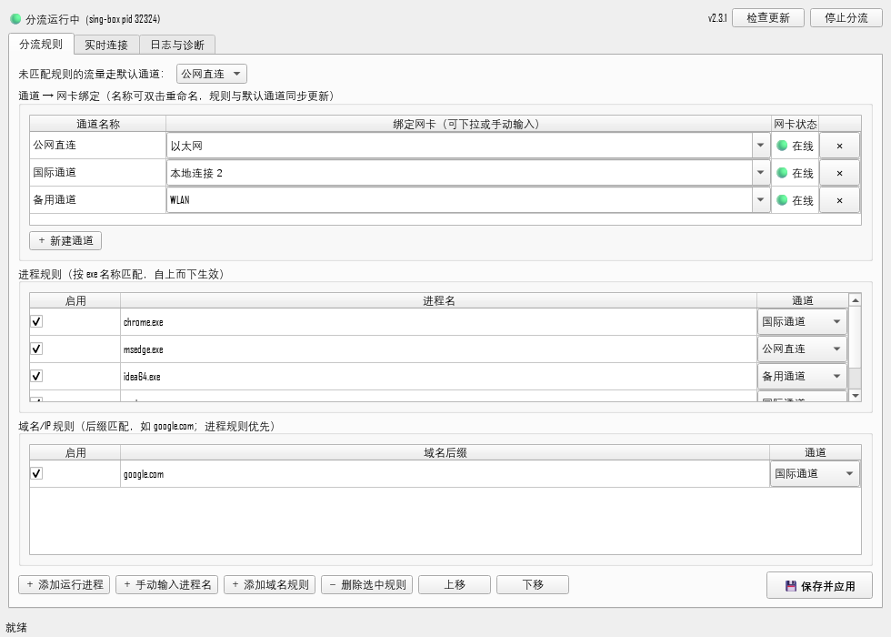
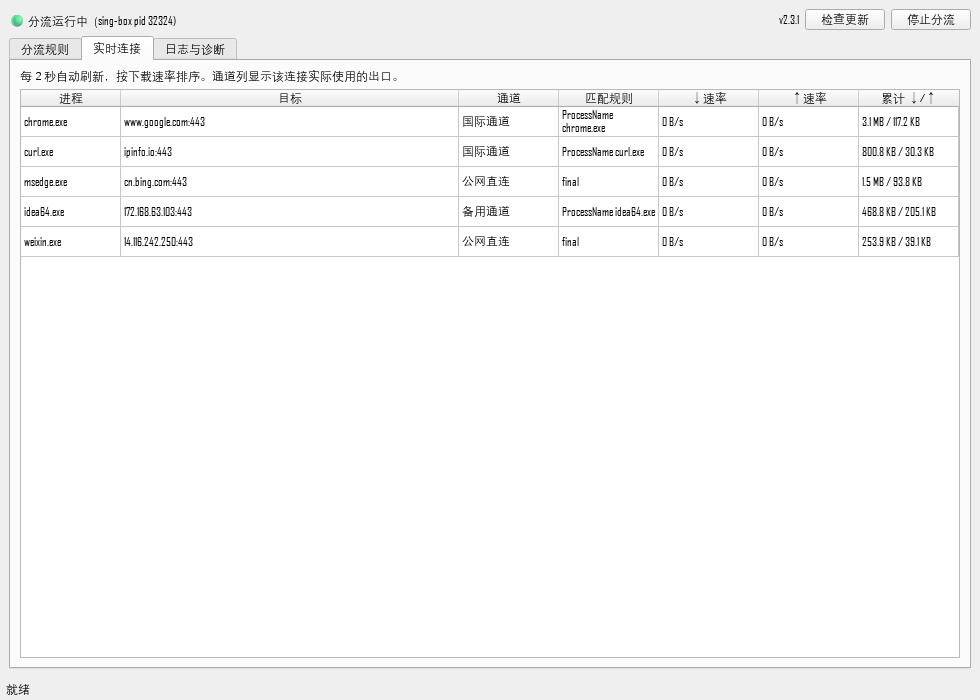
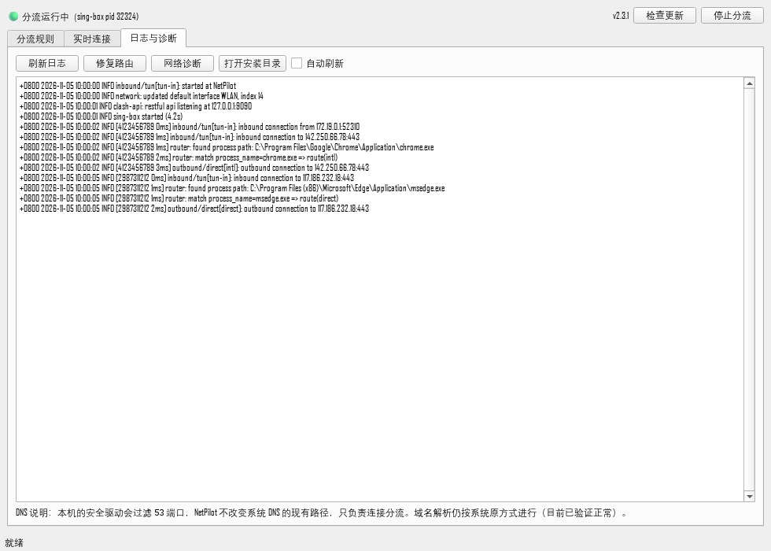

# NetPilot · 应用分流管家

> **让指定的应用程序，走指定的网络出口。**

Windows 自带的路由表只认识"目标 IP"，不认识"哪个程序"。NetPilot 做的事情只有一件，也是它的第一性原理——**分流**：给每个应用程序的网络连接，指定从哪一块网卡（哪个网络出口）发出去。

比如：

- 浏览器走"国际通道"网卡；
- 开发工具走"备用通道"网卡；
- 其余所有程序默认走"公网直连"网卡。

三条通道同时在线、互不干扰，规则随时改、秒级生效。

## 界面

| 分流规则 | 实时连接 | 日志与诊断 |
|---|---|---|
|  |  |  |

## 功能一览

- **按进程分流**：给任意 `xxx.exe` 指定出口通道（含浏览器多进程、UWP 应用）。
- **按域名分流**：补充 `域名后缀 → 通道` 规则，进程规则优先。
- **动态通道**：通道可新建、重命名、删除；每个通道绑定一块网卡。重命名后所有规则自动同步。
- **默认通道**：没有命中任何规则的流量走默认通道，可随时切换。
- **实时连接**：每 2 秒刷新，看到每个进程当前实际走的通道、速率与累计流量——用来验证规则是否生效。
- **日志与诊断**：内核日志、一键修复路由、网络诊断信息。
- **系统托盘**：最小化到托盘；右键可显示主窗口、启停分流、**彻底退出**（停内核、清路由、关服务，无残留）。
- **一键自动更新**：顶部"检查更新"，自动下载最新版并替换，规则配置保留。
- **稳定自愈**：单实例服务、孤儿内核清理、启动就绪检测、路由看门狗，避免"看起来在跑其实没生效"。
- **一键恢复**：网络异常时双击 `恢复网络.bat`，立即删除分流路由并停止内核。

## 快速开始

**系统要求**：Windows 10 / 11 x64，首次启动核心服务需要一次管理员授权（UAC），**无需安装 Python**。

1. 到 [Releases](https://github.com/Yuzuru0822/NetPilot/releases) 下载最新 `NetPilot-vX.Y.Z-win64.zip`，解压到任意目录（建议 `D:\NetPilot`）。
2. 双击 **`NetPilot.exe`** 打开界面。
3. 顶部点 **"启动核心服务（管理员）"**，UAC 弹窗点"是"。（每次开机只需一次；装了开机自启后免此步。）
4. 点 **"启动分流"**。顶部从"🟡 分流启动中"变成"🟢 分流运行中"即表示内核与虚拟网卡已就绪（个别机器需要 1–2 分钟，属正常）。
5. 在"分流规则"页给程序分配通道：
   - **通道绑定**：每个通道选一块网卡（可下拉也可手动输入网卡名）。
   - **进程规则**：点"＋ 添加运行进程"从正在运行的程序里选，或"＋ 手动输入进程名"直接填（如 `chrome.exe`）。
   - 改完点 **"💾 保存并应用"**。
6. 到 **"实时连接"** 页签验证：目标进程的连接应该显示在你指定的通道上。

## 操作指南

### 通道管理

- **绑定网卡**：通道 = "一块网卡"的别名。网卡名以"设置 → 网络和 Internet → 更改适配器选项"里看到的为准（如 `以太网`、`WLAN`、`本地连接 2`）。
- **新建通道**：点"＋ 新建通道"，自动分配内部 ID，改个名字、选网卡、保存应用即可。
- **重命名**：双击通道名称直接改；进程规则、默认通道下拉框会即时同步。
- **删除通道**：行尾 ✕。被规则使用或作为默认通道时不可删。
- **注意**：如果通道绑的是**第三方隧道客户端创建的虚拟网卡**，需要先在它自己的客户端里完成连接，该网卡才"在线"。NetPilot 只负责分流，不负责建立隧道；通道离线时，分配到该通道的程序会断网（把规则改到可用通道或先连接隧道即可）。

### 进程规则

- 按 exe 名称精确匹配（如 `chrome.exe`），**自上而下依次生效**，可用"上移/下移"调整顺序。
- 每行有"启用"开关，可临时停用而不删除。
- 内置的若干"系统/隧道类进程 → 公网直连"规则是为了避免通道自身的流量被分流接管，**请勿删除**。

### 域名规则

- 按后缀匹配（如 `google.com`），优先级低于进程规则。
- 局域网/私有地址段始终直连，不会进入分流内核。

### 实时连接

- 列含义：进程、目标、通道（实际出口）、匹配规则、上下行速率、累计流量。
- 这是验证"规则到底有没有生效"的第一现场：改了规则就来看它走没走对。

### 日志与诊断

- 查看内核最近日志（含每条连接的匹配过程）；可自动刷新。
- **修复路由**：当第三方隧道重连抢走了默认路由时使用（正常情况下看门狗每 5 秒会自动修）。
- **网络诊断**：导出系统过滤驱动与网络事件信息，用于疑难排查。

### 托盘

- 点窗口 X = 最小化到托盘，分流继续运行。
- 托盘右键：**显示主窗口 / 启动或停止分流 / 退出程序**。退出程序会彻底停止内核、清理路由并关闭核心服务，无后台残留。

### 自动更新与开机自启

- 顶部 **"检查更新"**：自动比对 GitHub 最新 Release、下载、替换并重启，`data\` 下的规则与配置全部保留。
- 开机自启（可选）：管理员 PowerShell 执行一次 `scripts\install_autostart.ps1`，之后核心服务随登录启动，不再弹 UAC；卸载用 `uninstall_autostart.ps1`。

## 工作原理

```
┌────────────────────────────────────────────────────┐
│  NetPilot.exe（界面，无需管理员）                     │
│  规则编辑 / 实时连接 / 日志 / 托盘                     │
└──────────────────────┬─────────────────────────────┘
                       │ 本地 HTTP（127.0.0.1，令牌认证）
┌──────────────────────▼─────────────────────────────┐
│  NetPilotAgent.exe（核心服务，管理员）                │
│  生命周期 / 就绪检测 / 路由修复 / 看门狗               │
└──────────────────────┬─────────────────────────────┘
                       │ 生成配置并守护
┌──────────────────────▼─────────────────────────────┐
│  分流内核（sing-box TUN 虚拟网卡）                     │
│  接管默认路由 → 按进程/域名规则匹配                    │
│  → 每条连接 bind 到指定物理/虚拟网卡发出               │
└────────────────────────────────────────────────────┘
```

- Windows 最长前缀优先。有些第三方隧道会用 `0.0.0.0/1`、`128.0.0.0/1` 抢默认路由；NetPilot 用同样两条 `/1` 但 metric 更低，把默认流量引导到自己的虚拟网卡，同时保留对方路由供"绑定对方网卡"的连接使用，因此可以**和平共存**。
- 启动时严格等待内核 API 与虚拟网卡就绪后才报告"运行中"；看门狗持续检测：内核异常退出先清路由恢复网络再拉起，路由被抢自动补。

## 隐私与安全

- 所有规则、配置保存在本机 `data\` 目录；核心服务仅监听 `127.0.0.1` 并带随机令牌。
- 除"检查更新"时访问 GitHub Releases 外，软件不主动向外发送任何数据。

## 常见问题

**Q：改了规则但程序没走指定通道？**
A：先确认顶部是"🟢 分流运行中"而不是"启动中"；然后到"实时连接"看该进程新连接走的通道。若仍不对，到"日志与诊断"看该连接的匹配过程，并尝试"修复路由"。

**Q：某个通道离线了会怎样？**
A：分配到该通道的程序会断网，其他通道不受影响。把规则切到在线通道，或让提供该网卡的通道先上线。

**Q：DNS 归谁管？**
A：NetPilot 不接管、不修改系统 DNS。个别安全软件会过滤 53 端口的 DNS 流量，如遇解析异常请优先排查本机安全软件，而不是本工具。

## 从源码部署与开发

```powershell
git clone https://github.com/Yuzuru0822/NetPilot.git D:\NetPilot
cd D:\NetPilot
powershell -ExecutionPolicy Bypass -File scripts\setup.ps1   # 建 venv、装依赖、下载内核
```

打包 exe：`scripts\build_exe.ps1`（界面）、`scripts\build_agent_exe.ps1`（核心服务）。
回归测试：`scripts\test_gui_fixes.py`、`scripts\test_gui_channels.py`（需本机已有内核与服务）。

技术栈：Python 3.12 + PySide6 + psutil + requests；sing-box TUN + `bind_interface` + `process_name` 规则。

## 目录结构

```
NetPilot\
  NetPilot.exe              界面（独立 exe）
  NetPilotAgent.exe         核心服务（独立 exe，管理员运行）
  启动NetPilot.bat           开发模式启动界面
  恢复网络.bat               一键恢复网络
  app\                     界面 / 服务 / 配置生成 / 更新 / 网卡枚举
  core\                    sing-box 内核（scripts\download_core.ps1 下载）
  data\                    你的规则、生成的内核配置、服务令牌（不入库）
  scripts\                 启停、自启、构建、诊断、测试脚本
  logs\                    内核与服务日志
  docs\                    文档与界面截图
```
